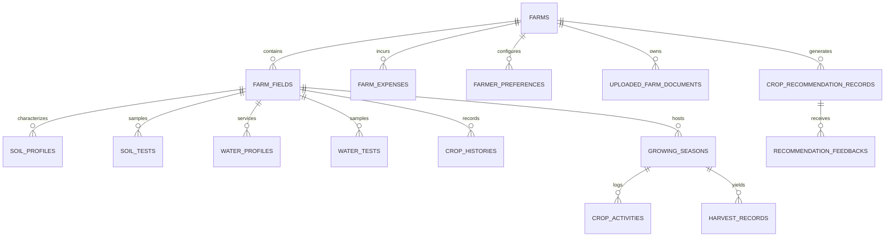

# GAIA — Farm Data Schema & Normalized Relational Architecture

## 1. Overview
The GAIA Farm Data Schema integrates farmer-reported observations, geospatial geometries, verified external telemetry, and laboratory reports into normalized, relational entities.

---

## 2. Relational Entity-Relationship Diagram

---

## 3. Normalized Database Models & Fields

### 1. `farms`
- `id`: UUID / Serial Primary Key.
- `farmerId`: Text / UUID (Tenant boundary; ensures cross-farmer isolation).
- `name`: Text (e.g., "Rancho Santa Cruz").
- `regionName`: Text (e.g., "Green Valley, Pima County, AZ").
- `latitude`: Double Precision (Farm centroid latitude).
- `longitude`: Double Precision (Farm centroid longitude).
- `boundaryGeojson`: JSONB (Polygon coordinates conforming to RFC 7946).
- `totalArea`: Double Precision.
- `areaUnit`: Text (`acre`, `hectare`, `square_meter`).
- `productionType`: Text (`open_field`, `greenhouse`, `dual`).
- `description`: Text (Optional farm bio).
- `completenessScore`: JSONB (Dimensional score for location, climate, soil, water, history, economics).
- `createdAt`, `updatedAt`: Timestamp.

### 2. `farm_fields`
- `id`: Serial Primary Key.
- `farmId`: Foreign Key $\rightarrow$ `farms.id` (Cascade Delete).
- `name`: Text (e.g., "North Pivot Block 1").
- `area`: Double Precision.
- `areaUnit`: Text (`acre`, `hectare`).
- `boundaryGeojson`: JSONB (Field polygon).
- `currentCrop`: Text (Nullable).
- `soilType`: Text (Nullable).
- `irrigationType`: Text (`drip`, `sprinkler`, `flood`, `none`).
- `isActive`: Boolean (Default true).

### 3. `soil_profiles`
- `id`: Serial Primary Key.
- `fieldId`: Foreign Key $\rightarrow$ `farm_fields.id`.
- `texture`: Text (`sandy_loam`, `clay`, `silt`, `loam`, `gravelly_sand`, `unknown`).
- `soilPh`: Double Precision (Nullable).
- `ecDsM`: Double Precision (Electrical conductivity $\text{dS/m}$).
- `organicMatterPercent`: Double Precision (Nullable).
- `nitrogenPpm`: Double Precision (Nullable).
- `phosphorusPpm`: Double Precision (Nullable).
- `potassiumPpm`: Double Precision (Nullable).
- `drainageClass`: Text (`well_drained`, `moderate`, `poor`, `excessive`).
- `salinityRisk`: Text (`none`, `slight`, `severe`, `unknown`).
- `provenanceStatus`: Text (`farmer_reported`, `lab_verified`, `ssurgo_regional`, `unavailable`).

### 4. `soil_tests`
- `id`: Serial Primary Key.
- `fieldId`: Foreign Key $\rightarrow$ `farm_fields.id`.
- `sampleDate`: Date.
- `sampleDepthCm`: Text (`0-15`, `15-30`, `30-60`).
- `labName`: Text.
- `documentId`: Foreign Key $\rightarrow$ `uploaded_farm_documents.id` (Nullable).
- `ph`: Double Precision.
- `ec`: Double Precision.
- `organicMatter`: Double Precision.
- `validationStatus`: Text (`pending_review`, `verified`, `rejected`).

### 5. `water_profiles`
- `id`: Serial Primary Key.
- `farmId`: Foreign Key $\rightarrow$ `farms.id`.
- `sourceType`: Text (`deep_well`, `shallow_well`, `canal_district`, `municipal_reclaimed`, `river`, `rainwater`).
- `wellDepthFeet`: Double Precision (Nullable, e.g., 320 ft in Upper Santa Cruz).
- `pumpingCapacityGpm`: Double Precision (Gallons per minute).
- `seasonalRestrictions`: Text.
- `volumetricCostPerAcreFoot`: Double Precision.
- `distributionUniformityPercent`: Double Precision (DU %, e.g., 88%).

### 6. `water_tests`
- `id`: Serial Primary Key.
- `waterProfileId`: Foreign Key $\rightarrow$ `water_profiles.id`.
- `testDate`: Date.
- `ph`: Double Precision.
- `ecDsM`: Double Precision.
- `tdsPpm`: Double Precision.
- `sar`: Double Precision (Sodium Adsorption Ratio).
- `documentId`: Foreign Key $\rightarrow$ `uploaded_farm_documents.id` (Nullable).
- `validationStatus`: Text (`pending_review`, `verified`).

### 7. `crop_histories`
- `id`: Serial Primary Key.
- `fieldId`: Foreign Key $\rightarrow$ `farm_fields.id`.
- `seasonYear`: Integer (e.g., 2024).
- `seasonName`: Text (`Fall-Winter`, `Spring`, `Monsoon`).
- `cropName`: Text.
- `cropCode`: Text.
- `plantingDate`: Date (Nullable).
- `harvestDate`: Date (Nullable).
- `actualYield`: Double Precision.
- `yieldUnit`: Text (`lbs/acre`, `tons/ha`, `crates/acre`).
- `fertilizersUsed`: Text.
- `pesticidesUsed`: Text.
- `pestIncidents`: Text.
- `farmerAssessment`: Text (`successful`, `moderate`, `failed`).

### 8. `growing_seasons`
- `id`: Serial Primary Key.
- `fieldId`: Foreign Key $\rightarrow$ `farm_fields.id`.
- `seasonName`: Text (e.g., "Fall 2026 Broccoli Production").
- `cropCode`: Text.
- `cropName`: Text.
- `startDate`: Date.
- `expectedHarvestDate`: Date.
- `actualHarvestDate`: Date (Nullable).
- `cultivatedAreaAcre`: Double Precision.
- `status`: Text (`planned`, `active`, `harvested`, `terminated`).

### 9. `crop_activities`
- `id`: Serial Primary Key.
- `seasonId`: Foreign Key $\rightarrow$ `growing_seasons.id`.
- `activityType`: Text (`irrigation`, `fertilization`, `pesticide`, `planting`, `pruning`, `scouting`, `harvest`).
- `activityDate`: Date.
- `quantity`: Double Precision.
- `unit`: Text (`gallons`, `lbs_n`, `oz_acre`, `hours`).
- `notes`: Text.
- `documentId`: Foreign Key $\rightarrow$ `uploaded_farm_documents.id` (Nullable).

### 10. `farm_expenses`
- `id`: Serial Primary Key.
- `farmId`: Foreign Key $\rightarrow$ `farms.id`.
- `category`: Text (`seeds`, `fertilizer`, `chemicals`, `labor`, `irrigation_pumping`, `machinery`, `packaging`, `transport`).
- `costPerAcre`: Double Precision.
- `totalCost`: Double Precision.
- `currency`: Text (`USD`, `EUR`, `EGP`).
- `applicableYear`: Integer.

### 11. `farmer_preferences`
- `id`: Serial Primary Key.
- `farmId`: Foreign Key $\rightarrow$ `farms.id`.
- `primaryObjective`: Text (`maximize_profit`, `conserve_water`, `minimize_risk`, `organic_certification`).
- `preferredCropCodes`: JSONB (Array of string codes).
- `excludedCropCodes`: JSONB (Array of string codes with reasons).
- `maxSeasonalBudget`: Double Precision.
- `waterConstraintAcreFeet`: Double Precision.
- `riskTolerance`: Text (`low`, `moderate`, `high`).
- `targetMarket`: Text (`wholesale_shipping`, `direct_csa`, `local_restaurant`, `processors`).

### 12. `crop_recommendation_records` & `recommendation_feedbacks`
- Stores personalized crop recommendation runs and records farmer acceptances/rejections with documented reasons for model refinement.

### 13. `uploaded_farm_documents`
- `id`: Serial Primary Key.
- `farmId`: Foreign Key $\rightarrow$ `farms.id`.
- `fileName`: Text.
- `fileType`: Text (`soil_test_pdf`, `water_test_pdf`, `invoice`, `photo`).
- `fileSize`: Integer.
- `mimeType`: Text (`application/pdf`, `image/jpeg`, `image/png`).
- `storagePath`: Text (Local / Object store path; isolated per tenant).
- `verificationStatus`: Text (`unverified`, `verified`, `flagged`).
- `uploadedAt`: Timestamp.
